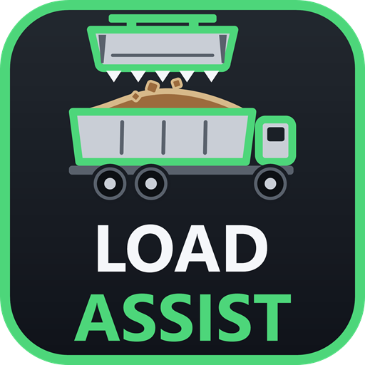
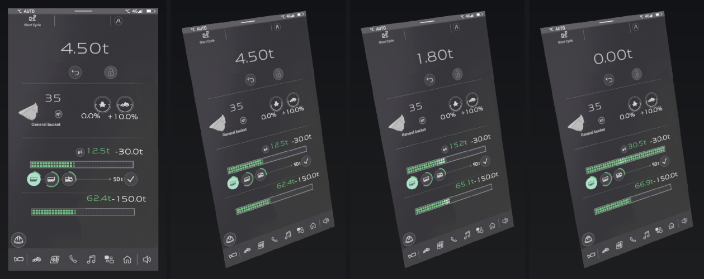
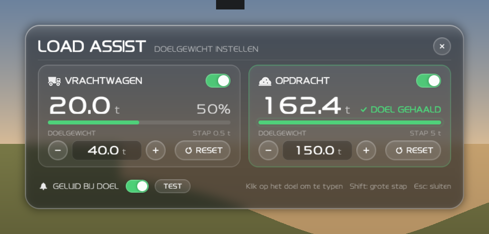
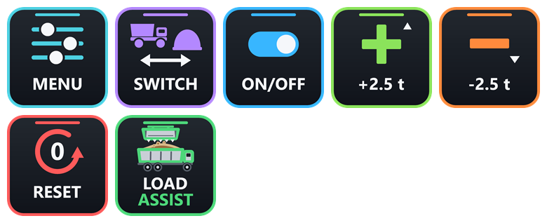

<p align="center">
  
</p>

<p align="center"><a href="README.md">Nederlands</a> · <b>English</b></p>

# LoadAssist for Farming Simulator 25

LoadAssist is an on-board weighing system for wheel loaders and excavators in Farming Simulator 25. The luminous screen in the cab shows how much is in the bucket, the bucket angle, how steep the machine stands and how much you have loaded for the truck and for the whole job, with bars of separate pixels that follow along while you unload. You set the target weights in a menu, and when you reach a target, you hear a pling.

LoadAssist is a *specialization*: a piece of behaviour that a vehicle uses. On its own the mod does nothing. A vehicle mod adds it with one line in its `modDesc.xml` and a `<loadAssist>` tag in the vehicle xml (see [Adding it to a vehicle](#adding-it-to-a-vehicle)).

## What it does

- **Weighing**: the weight in the bucket comes from the fill units of the bucket and the machine. The machine's own tanks (diesel, DEF, air, electric charge, methane) do not count.
- **Two counters**, *Vrachtwagen* (Truck) and *Opdracht* (Job), each with a progress bar and a target weight. What leaves the bucket shows up right away at the counters that are on: the numbers and the bars follow along while you unload. As soon as the bucket is empty, or when you scoop up more, that load really counts.
- **Menu** (<kbd>Ctrl</kbd> + <kbd>R</kbd>) in "liquid glass" style: set the target weight with − and + (Shift = x10), the mouse wheel or by typing, switch counters on or off, RESET, and switch the sound on or off with a test button.
- **Pling and notification** when a counter reaches its target weight. The pling is the mod's own two-tone sound; you can set a different sound or volume per vehicle in the xml.
- **Screen in the cab**: off, start-up (3 s) and main screen with the weight, bucket angle (with a degree sign), front/back and left/right slope, and the counters. The small bucket on the screen turns along with the real bucket.
- **Luminous screen**, just like in DigAssist: from the cab, LoadAssist draws the screen itself, in perspective exactly over the 3D screen. It lights up, also at night and in the shade. With three corner nodes from GIANTS Editor you put it exactly in place.
- **Pixel bars**: the Truck and Job bars are made of separate pixels. While a bar grows, the pixels at its head light up; when the target is reached, a shine runs through the bar.
- **HandelGothic font** (the same as in DigAssist) for the texts on the screen and in the menu.
- **Saving**: target weights, counters and the sound setting are kept per vehicle in the savegame. In multiplayer the server counts and everyone sees the same values, also players who join later; a dedicated server saves them correctly too.
- **Stream Deck icons** for every function.
- **Documentation** in Dutch and English: you switch the language at the top of the page.

The mod's own texts in the game (menu, screen and notifications) are in Dutch for now. A short glossary: *Vrachtwagen* = Truck, *Opdracht* = Job, *Doelgewicht* = target weight, *DOEL GEHAALD* = target reached, *Geluid bij doel* = sound at target, *WISSEL* = switch, *AAN/UIT* = on/off.

<p align="center">
  
</p>

<p align="center">
  
</p>

## Requirements

- Farming Simulator 25
- A vehicle that uses LoadAssist

## Installation

1. Put the folder `FS25_0_LoadAssist`, or a zip with the same name, in `Documents\My Games\FarmingSimulator2025\mods`.
2. In the game, select the LoadAssist mod and the vehicle when you load your savegame.

> **Mind the name.** Vehicles refer to `FS25_0_LoadAssist.loadAssist`, so the folder or zip must be called exactly `FS25_0_LoadAssist`. If you get the mod from GitHub, the folder is called `FS25_LoadAssist` (clone) or `FS25_LoadAssist-main` (*Download ZIP*): rename it to `FS25_0_LoadAssist`. The zip from *Download ZIP* itself does not work as a mod zip, because it contains another folder; make one with the command below.

### Making a zip for the game

From this folder, this command makes a clean zip of the latest commit, without the git files, with `modDesc.xml` at the top:

```powershell
git archive --format=zip --output=..\..\FS25_0_LoadAssist.zip HEAD
```

The zip ends up in the `FarmingSimulator2025` folder, outside `mods`. Only put it in `mods` once the `FS25_0_LoadAssist` folder is gone from there: if both the folder and the zip are there, the game loads only one of them.

## Keys

The default keys; <kbd>Ctrl</kbd> and <kbd>Shift</kbd> are the left-hand keys. You can change them in the game's controls settings. The keys outside the menu work on the selected counter.

| Function | Key | What it does |
|---|---|---|
| MENU | <kbd>Ctrl</kbd> + <kbd>R</kbd> | Opens or closes the menu with the target weights. |
| SWITCH | <kbd>Ctrl</kbd> + <kbd>H</kbd> | Selects the other counter: Truck or Job. |
| ON/OFF | <kbd>Shift</kbd> + <kbd>L</kbd> | Switches the selected counter on or off. |
| +2.5 t | <kbd>Ctrl</kbd> + <kbd>L</kbd> | Raises the target of the selected counter by 2.5 t. |
| -2.5 t | <kbd>Ctrl</kbd> + <kbd>U</kbd> | Lowers the target of the selected counter by 2.5 t. |
| RESET | <kbd>Ctrl</kbd> + <kbd>O</kbd> | Sets the selected counter to 0.0 t. |

If you already used an earlier version of LoadAssist and the game saved your keys, the old keys may stay. Then set them yourself in the controls settings.

<p align="center">
  
</p>

The icons are 144 × 144 pixel PNG files in [`streamdeck-icons/en`](streamdeck-icons/en); the Dutch version is in [`streamdeck-icons/nl`](streamdeck-icons/nl). In the Stream Deck app, first put the *Hotkey* action on a key and set the key from the table. Then drag the icon onto the icon box of that action.

### In the menu

| Input | What it does |
|---|---|
| − and + | Target one step lower or higher: 0.5 t for Truck, 5 t for Job. With <kbd>Shift</kbd> ten times as much. |
| Mouse wheel over a card | Target of that card one step higher or lower. |
| Click the target, or type a number | Type the target. <kbd>Enter</kbd> saves, <kbd>Esc</kbd> cancels, <kbd>Tab</kbd> goes to the other card. |
| Right-click the target | Target back to the default from the vehicle xml. |
| <kbd>←</kbd> <kbd>→</kbd> / <kbd>↑</kbd> <kbd>↓</kbd> | Select the other card / target one step higher or lower. |
| <kbd>Esc</kbd>, <kbd>Ctrl</kbd> + <kbd>R</kbd>, the cross or clicking next to the panel | Close the menu. |

## Adding it to a vehicle

**1. In the vehicle's `modDesc.xml`**

```xml
<vehicleTypes>
  <type name="LoadAssist" parent="baseDrivable" className="Vehicle" filename="$dataS/scripts/vehicles/Vehicle.lua">
    <!-- mod name of LoadAssist + dot + loadAssist -->
    <specialization name="FS25_0_LoadAssist.loadAssist" />
  </type>
</vehicleTypes>

<dependencies>
  <dependency>FS25_0_LoadAssist</dependency>
</dependencies>
```

**2. In the vehicle xml: the smallest working example**

```xml
<loadAssist mainScreenNode="0>0|3|0|0|5|1|0|2|0|2">
  <bars truckBarNode="0>0|3|0|0|5|1|0|2|3|0" truckTarget="25.0" />
  <texts fontName="HANDELGOTHIC" fontSize="0.009" fontThickness="2.0"
         bucketWeightNode="0>0|3|0|0|5|1|0|2|4|0"
         truckLoadedNode="0>0|3|0|0|5|1|0|2|4|4"
         truckTargetNode="0>0|3|0|0|5|1|0|2|4|5" />
</loadAssist>
```

A value like `0>0|3|0|0|5|1|0|2|0|2` refers to a node in the vehicle i3d. Everything in the tag is optional; if you leave something out, only that part does not work. The groups are `nodes`, `realParts`, `screenParts`, `bars`, `texts`, `screen` and `sound`; the three screens are on the tag itself. The old notation (`<parts>` and `slopeRefNode` on the tag) still works.

HandelGothic is drawn thin: with a `fontThickness` below 1 nothing is left of the letters, so the mod uses 1 then. 2.0 looks best.

Without `<sound>`, the LoadAssist pling plays at volume 2. With `<sound file="..." volume="..." />` you choose a different sound (a path in the vehicle mod, or with `$data/` a sound of the game) or a different volume.

### Placing the screen exactly

The luminous screen is on by default and finds its place from the main screen and the text nodes. If it is not exactly on the 3D screen, put it in place with three corner nodes:

1. Open the vehicle i3d in GIANTS Editor and find the main screen (`mainScreenNode`) in the Scenegraph.
2. Create three empty transform groups (*Create → TransformGroup*) under the group of the screen, as the last children: that way the paths of the other nodes stay the same. Name them for example `cornerTopLeft`, `cornerTopRight` and `cornerBottomLeft`.
3. Place them exactly on the corners of the picture: top left, top right and bottom left, as you see the screen from the seat. You do not need to rotate them; the fourth corner follows by itself.
4. Save the i3d and put the paths in the xml, first with `debug="true"`:

   ```xml
   <screen topLeftNode="..." topRightNode="..." bottomLeftNode="..." debug="true" />
   ```

5. In the game there is now a large magenta cross on each corner node. When it is right, set `debug` back to `false`.

Small corrections go with `offset` (in metres: right, up and optionally towards the driver) and `roll` (in degrees). Without corner nodes you can also use `size`. With the console command `gsVehicleReload` you reload an unpacked vehicle mod without restarting the game. The full explanation is in the documentation under *Placing the screen*.

### Full documentation

All attributes, a full example and "Troubleshooting" are in [`docs/LoadAssist-documentatie.html`](docs/LoadAssist-documentatie.html), in Dutch and English. GitHub only shows an HTML file as code: download the file (*Download raw file* button) and open it in your browser.

## Folders

| Folder / file | Contents |
|---|---|
| [`scripts/LoadAssist.lua`](scripts/LoadAssist.lua) | The specialization: screen, weighing, counters, target weight, keys and sound |
| [`scripts/LoadAssistScreen.lua`](scripts/LoadAssistScreen.lua) | The luminous screen from the cab: screen plane, perspective, pixel bars and texts |
| [`scripts/LoadAssistMenu.lua`](scripts/LoadAssistMenu.lua) | The menu to set the target weights |
| [`scripts/LoadAssistEvent.lua`](scripts/LoadAssistEvent.lua) | Multiplayer: what a player sets goes through the server to the others |
| [`fonts`](fonts) | Fonts: HandelGothic for the 3D letters (`customFonts.xml`) and for the menu and the luminous screen (`handelgothic_overlay.dds`), and the older `DIGASSIST_FONT` |
| [`sounds`](sounds) | The pling when a target is reached (`targetReached.wav`) |
| [`textures`](textures) | The menu images (glass, shadow and icons) and `pixel.png` for the luminous screen |
| [`streamdeck-icons`](streamdeck-icons) | Icons for the Stream Deck in English (`en`) and Dutch (`nl`), and the logo |
| [`docs`](docs) | The documentation |
| `modDesc.xml`, `icon.dds` | Description of the mod and the icon in the game |

## Version

1.1.0.0, by Knager.

New in 1.1:

- Menu to set the target weights, reset the counters and switch the sound on or off
- The mod's own pling and a notification when a counter reaches its target weight
- HandelGothic font, also for the texts on the screen
- Luminous screen from the cab, like in DigAssist, with bars of separate pixels that follow along while loading
- Place the luminous screen exactly with three corner nodes from GIANTS Editor; `offset` can also move it towards the driver
- `size` and `offset` are always in metres, also when the screen node is scaled or mirrored
- The bottom of the letters (as with the 0) is no longer cut off on the luminous screen
- The bucket angle with a degree sign
- New default keys: <kbd>Ctrl</kbd> + <kbd>R</kbd>, <kbd>Ctrl</kbd> + <kbd>H</kbd>, <kbd>Shift</kbd> + <kbd>L</kbd>, <kbd>Ctrl</kbd> + <kbd>L</kbd>, <kbd>Ctrl</kbd> + <kbd>U</kbd> and <kbd>Ctrl</kbd> + <kbd>O</kbd>
- The counters follow along while you unload
- The 3D letters light up (`emissiveScale`), and a `fontThickness` that is too thin becomes 1 so the text is always visible
- Target weights, counters and the sound setting are kept in the savegame
- Multiplayer: the server counts the loads and everyone sees the same target weights and counters; players who join later get them too, and a dedicated server keeps them in the savegame
- The rotation of the screen bucket (`minRot`, `zeroRot`, `maxRot`) and the sound can be set in the xml
- When the engine stops, the progress bars switch off too
- New mod icon and Stream Deck icons
- Documentation in Dutch and English
