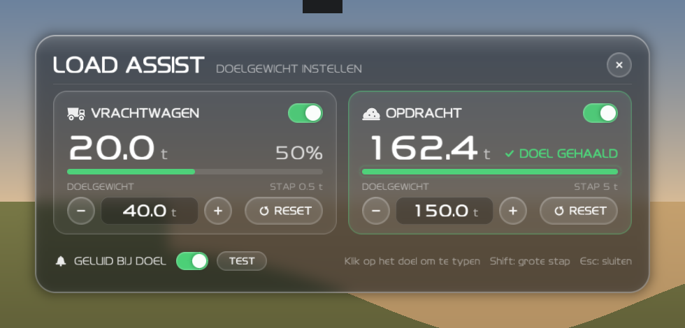
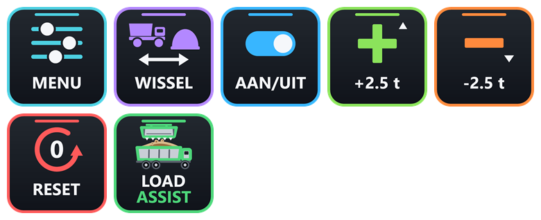

<p align="center">
  
</p>

# LoadAssist voor Farming Simulator 25

LoadAssist is een weegsysteem voor wielladers en graafmachines in Farming Simulator 25. Op het scherm in de cabine zie je hoeveel er in de bak zit, de bakhoek, hoe schuin de machine staat en hoeveel je al geladen hebt voor de vrachtwagen en voor de hele opdracht. In een menu stel je de doelgewichten in, en haal je een doel, dan hoor je een geluid.

LoadAssist is een *specialization*: een stukje gedrag dat een voertuig gebruikt. Op zichzelf doet de mod niets. Een voertuigmod voegt hem toe met één regel in zijn `modDesc.xml` en een `<loadAssist>` tag in de xml van het voertuig (zie [Toevoegen aan een voertuig](#toevoegen-aan-een-voertuig)). De Volvo L90 (`FS25_volvoL90`) gebruikt hem.

## Wat het doet

- **Wegen**: het gewicht in de bak komt uit de vulunits van de bak en de machine. De eigen tanks van de machine (diesel, AdBlue, lucht, stroom, methaan) tellen niet mee.
- **Twee tellers**, *Vrachtwagen* en *Opdracht*, elk met een voortgangsbalk en een doelgewicht. Zodra de bak leeg is, telt het hoogste gewicht van die lading mee bij de tellers die aan staan.
- **Menu** (<kbd>Num /</kbd>) in "liquid glass"-stijl: doelgewicht instellen met − en + (Shift = x10), het muiswiel of door te typen, tellers aan/uit, RESET, en het geluid aan/uit met een testknop.
- **Geluid en melding** als een teller zijn doelgewicht haalt. Het geluid kies je per voertuig in de xml.
- **Scherm in de cabine**: uit, opstarten (3 s) en hoofdscherm met gewicht, bakhoek, helling voor/achter en links/rechts, en de tellers. De kleine bak op het scherm draait mee met de echte bak.
- **Lettertype HandelGothic** (hetzelfde als in DigAssist) voor de teksten op het scherm en in het menu.
- **Opslaan**: doelgewichten, tellers en het geluid worden per voertuig in de savegame bewaard.
- **Stream Deck-iconen** voor alle functies.

<p align="center">
  
</p>

## Vereisten

- Farming Simulator 25
- Een voertuig dat LoadAssist gebruikt, bijvoorbeeld de Volvo L90

## Installatie

1. Zet de map `FS25_0_LoadAssist`, of een zip met dezelfde naam, in `Documenten\My Games\FarmingSimulator2025\mods`.
2. Kies in het spel bij het laden van je savegame de mods LoadAssist en het voertuig.

> **Let op de naam.** Voertuigen verwijzen naar `FS25_0_LoadAssist.loadAssist`, dus de map of zip moet precies `FS25_0_LoadAssist` heten. Haal je de mod van GitHub, dan heet de map `FS25_LoadAssist` (clone) of `FS25_LoadAssist-main` (*Download ZIP*): hernoem die naar `FS25_0_LoadAssist`. De zip van *Download ZIP* zelf werkt niet als mod-zip, want daarin zit nog een map; maak er een met het commando hieronder.

### Een zip maken voor in het spel

Vanuit deze map maakt dit commando een schone zip van de laatste commit, zonder de git-bestanden, met `modDesc.xml` bovenin:

```powershell
git archive --format=zip --output=..\..\FS25_0_LoadAssist.zip HEAD
```

De zip komt in de map `FarmingSimulator2025`, buiten `mods`. Zet hem pas in `mods` als de map `FS25_0_LoadAssist` daar weg is: staan de map en de zip er allebei, dan laadt het spel er maar één.

## Toetsen

De standaardtoetsen. Je kunt ze in het spel veranderen bij de besturing. De Num-toetsen werken alleen als NumLock aan staat. De toetsen buiten het menu werken op de gekozen teller.

| Functie | Toets | Wat het doet |
|---|---|---|
| MENU | <kbd>Num /</kbd> | Opent of sluit het menu met de doelgewichten. |
| WISSEL | <kbd>Alt</kbd> + <kbd>1</kbd> | Kiest de andere teller: Vrachtwagen of Opdracht. |
| AAN/UIT | <kbd>Alt</kbd> + <kbd>2</kbd> | Zet de gekozen teller aan of uit. |
| +2.5 t | <kbd>Alt</kbd> + <kbd>=</kbd> | Doel van de gekozen teller 2,5 t hoger. |
| -2.5 t | <kbd>Alt</kbd> + <kbd>-</kbd> | Doel van de gekozen teller 2,5 t lager. |
| RESET | <kbd>Alt</kbd> + <kbd>0</kbd> | Zet de gekozen teller op 0,0 t. |

<p align="center">
  
</p>

De iconen staan als PNG van 144 × 144 pixels in [`streamdeck-icons`](streamdeck-icons). Zet in de Stream Deck-app eerst de actie *Hotkey* op een toets en stel de toets uit de tabel in. Sleep daarna het icoon op het icoonvakje van die actie.

### In het menu

| Invoer | Wat het doet |
|---|---|
| − en + | Doel een stap lager of hoger: 0,5 t voor Vrachtwagen, 5 t voor Opdracht. Met <kbd>Shift</kbd> tien keer zo veel. |
| Muiswiel boven een kaart | Doel van die kaart een stap hoger of lager. |
| Klik op het doel, of typ een cijfer | Doel typen. <kbd>Enter</kbd> slaat op, <kbd>Esc</kbd> breekt af, <kbd>Tab</kbd> gaat naar de andere kaart. |
| Rechtsklik op het doel | Doel terug naar de standaardwaarde uit de xml van het voertuig. |
| <kbd>←</kbd> <kbd>→</kbd> / <kbd>↑</kbd> <kbd>↓</kbd> | Andere kaart kiezen / doel een stap hoger of lager. |
| <kbd>Esc</kbd>, <kbd>Num /</kbd>, het kruisje of naast het paneel klikken | Menu sluiten. |

## Toevoegen aan een voertuig

**1. In de `modDesc.xml` van het voertuig**

```xml
<vehicleTypes>
  <type name="LoadAssist" parent="baseDrivable" className="Vehicle" filename="$dataS/scripts/vehicles/Vehicle.lua">
    <!-- modnaam van LoadAssist + punt + loadAssist -->
    <specialization name="FS25_0_LoadAssist.loadAssist" />
  </type>
</vehicleTypes>

<dependencies>
  <dependency>FS25_0_LoadAssist</dependency>
</dependencies>
```

**2. In de xml van het voertuig: het kleinste werkende voorbeeld**

```xml
<loadAssist mainScreenNode="0>0|3|0|0|5|1|0|2|0|2">
  <bars truckBarNode="0>0|3|0|0|5|1|0|2|3|0" truckTarget="25.0" />
  <texts fontName="HANDELGOTHIC" fontSize="0.009"
         bucketWeightNode="0>0|3|0|0|5|1|0|2|4|0"
         truckLoadedNode="0>0|3|0|0|5|1|0|2|4|4"
         truckTargetNode="0>0|3|0|0|5|1|0|2|4|5" />
</loadAssist>
```

Een waarde als `0>0|3|0|0|5|1|0|2|0|2` verwijst naar een node in de i3d van het voertuig. Alles in de tag is optioneel; laat je iets weg, dan werkt alleen dat onderdeel niet. De groepen zijn `nodes`, `realParts`, `screenParts`, `bars`, `texts` en `sound`; de drie schermen staan op de tag zelf. De oude schrijfwijze (`<parts>` en `slopeRefNode` op de tag) werkt nog.

### Volledige documentatie

Alle attributen, een volledig voorbeeld en "Problemen oplossen" staan in [`docs/LoadAssist-documentatie.html`](docs/LoadAssist-documentatie.html). GitHub laat een HTML-bestand alleen als code zien: download het bestand (knop *Download raw file*) en open het in je browser.

## Mappen

| Map / bestand | Inhoud |
|---|---|
| [`scripts/LoadAssist.lua`](scripts/LoadAssist.lua) | De specialization: scherm, meten, tellers, doelgewicht en toetsen |
| [`scripts/LoadAssistMenu.lua`](scripts/LoadAssistMenu.lua) | Het menu om de doelgewichten in te stellen |
| [`fonts`](fonts) | Lettertypen: HandelGothic voor de 3D-letters (`customFonts.xml`) en voor het menu (`handelgothic_overlay.dds`), en het oudere `DIGASSIST_FONT` |
| [`textures`](textures) | De afbeeldingen van het menu: glas, schaduw en iconen |
| [`streamdeck-icons`](streamdeck-icons) | Iconen voor de Stream Deck en het logo |
| [`docs`](docs) | De documentatie |
| `modDesc.xml`, `icon.dds` | Beschrijving van de mod en het icoon in het spel |

## Versie

1.1.0.0, door Knager.

Nieuw in 1.1:

- Menu om de doelgewichten in te stellen, de tellers te resetten en het geluid aan of uit te zetten
- Geluid en melding als een teller zijn doelgewicht haalt
- Lettertype HandelGothic, ook voor de teksten op het scherm
- Doelgewichten, tellers en het geluid worden in de savegame bewaard
- De draaiing van de schermbak (`minRot`, `zeroRot`, `maxRot`) en het geluid zijn in de xml in te stellen
- Als de motor uit gaat, gaan ook de voortgangsbalken uit
- Nieuw mod-icoon en Stream Deck-iconen
