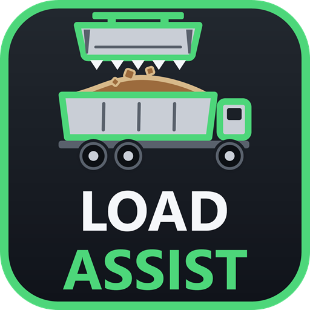
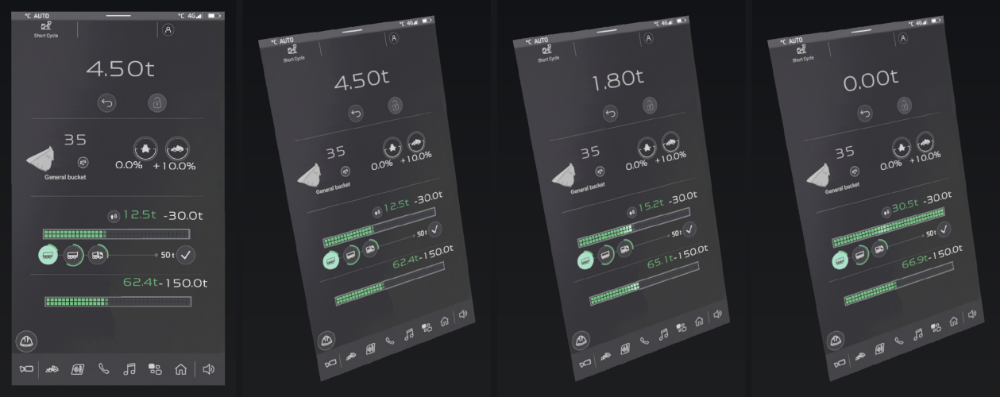

<p align="center">
  
</p>

<p align="center"><b>Nederlands</b> · <a href="README.en.md">English</a></p>

# LoadAssist voor Farming Simulator 25

LoadAssist is een weegsysteem voor wielladers en graafmachines in Farming Simulator 25. Op het lichtgevende scherm in de cabine zie je hoeveel er in de bak zit, de bakhoek, hoe schuin de machine staat en hoeveel je al geladen hebt voor de vrachtwagen en voor de hele opdracht, met balken van losse pixels die meelopen terwijl je lost. In een menu stel je de doelgewichten in, en haal je een doel, dan hoor je een pling.

LoadAssist is een *specialization*: een stukje gedrag dat een voertuig gebruikt. Op zichzelf doet de mod niets. Een voertuigmod voegt hem toe met één regel in zijn `modDesc.xml` en een `<loadAssist>` tag in de xml van het voertuig (zie [Toevoegen aan een voertuig](#toevoegen-aan-een-voertuig)).

## Wat het doet

- **Wegen**: het gewicht in de bak komt uit de vulunits van de bak en de machine. De eigen tanks van de machine (diesel, AdBlue, lucht, stroom, methaan) tellen niet mee.
- **Twee tellers**, *Vrachtwagen* en *Opdracht*, elk met een voortgangsbalk en een doelgewicht. Wat er uit de bak gaat, staat meteen bij de tellers die aan staan: de cijfers en de balken lopen mee terwijl je lost. Zodra de bak leeg is, of als je weer bijschept, telt die lading echt mee.
- **Menu** (<kbd>Ctrl</kbd> + <kbd>R</kbd>) in "liquid glass"-stijl: doelgewicht instellen met − en + (Shift = x10), het muiswiel of door te typen, tellers aan/uit, RESET, en het geluid aan/uit met een testknop.
- **Pling en melding** als een teller zijn doelgewicht haalt. De pling is een eigen geluid van twee tonen; een ander geluid of volume stel je per voertuig in de xml in.
- **Scherm in de cabine**: uit, opstarten (3 s) en hoofdscherm met gewicht, bakhoek (met gradenteken), helling voor/achter en links/rechts, en de tellers. De kleine bak op het scherm draait mee met de echte bak.
- **Lichtgevend scherm**, net als bij DigAssist: vanuit de cabine tekent LoadAssist het scherm zelf, in perspectief precies over het 3D-scherm heen. Het licht op, ook 's nachts en in de schaduw. Met drie hoek-nodes uit GIANTS Editor zet je het precies op zijn plek.
- **Pixelbalken**: de balken van Vrachtwagen en Opdracht bestaan uit losse pixels. Zolang een balk groeit, lichten de pixels aan de kop op; is het doel gehaald, dan loopt er een glans door de balk.
- **Lettertype HandelGothic** (hetzelfde als in DigAssist) voor de teksten op het scherm en in het menu.
- **Opslaan**: doelgewichten, tellers en het geluid worden per voertuig in de savegame bewaard. In multiplayer telt de server en ziet iedereen dezelfde waarden, ook wie later meedoet; een dedicated server bewaart ze ook goed.
- **Stream Deck-iconen** voor alle functies.
- **Documentatie** in het Nederlands en het Engels: bovenaan de pagina wissel je van taal.

<p align="center">
  
</p>

<p align="center">
  
</p>

## Vereisten

- Farming Simulator 25
- Een voertuig dat LoadAssist gebruikt

## Installatie

1. Zet de map `FS25_0_LoadAssist`, of een zip met dezelfde naam, in `Documenten\My Games\FarmingSimulator2025\mods`.
2. Kies in het spel bij het laden van je savegame de mods LoadAssist en het voertuig.

> **Let op de naam.** Voertuigen verwijzen naar `FS25_0_LoadAssist.loadAssist`, dus de map of zip moet precies `FS25_0_LoadAssist` heten. Haal je de mod van GitHub, dan heet de map `FS25_LoadAssist` (clone) of `FS25_LoadAssist-main` (*Download ZIP*): hernoem die naar `FS25_0_LoadAssist`. De zip van *Download ZIP* zelf werkt niet als mod-zip, want daarin zit nog een map; maak er een met het commando hieronder.

### Een zip maken voor in het spel

Vanuit deze map maakt dit commando een schone zip van de laatste commit, zonder de git-bestanden, met `modDesc.xml` bovenin:

```powershell
git archive --format=zip --output=..\..\FS25_0_LoadAssist.zip HEAD
```

De zip komt in de map `FarmingSimulator2025`, buiten `mods`. Zet hem pas in `mods` als de map `FS25_0_LoadAssist` daar weg is: staan de map en de zip er allebei, dan laadt het spel er maar één.

## Toetsen

De standaardtoetsen; <kbd>Ctrl</kbd> en <kbd>Shift</kbd> zijn de linkertoetsen. Je kunt ze in het spel veranderen bij de besturing. De toetsen buiten het menu werken op de gekozen teller.

| Functie | Toets | Wat het doet |
|---|---|---|
| MENU | <kbd>Ctrl</kbd> + <kbd>R</kbd> | Opent of sluit het menu met de doelgewichten. |
| WISSEL | <kbd>Ctrl</kbd> + <kbd>H</kbd> | Kiest de andere teller: Vrachtwagen of Opdracht. |
| AAN/UIT | <kbd>Shift</kbd> + <kbd>L</kbd> | Zet de gekozen teller aan of uit. |
| +2.5 t | <kbd>Ctrl</kbd> + <kbd>L</kbd> | Doel van de gekozen teller 2,5 t hoger. |
| -2.5 t | <kbd>Ctrl</kbd> + <kbd>U</kbd> | Doel van de gekozen teller 2,5 t lager. |
| RESET | <kbd>Ctrl</kbd> + <kbd>O</kbd> | Zet de gekozen teller op 0,0 t. |

Had je al een eerdere versie van LoadAssist en heeft het spel je toetsen opgeslagen, dan kunnen de oude toetsen blijven staan. Stel ze dan zelf in bij de besturing.

<p align="center">
  
</p>

De iconen staan als PNG van 144 × 144 pixels in [`streamdeck-icons/nl`](streamdeck-icons/nl); de Engelse versie staat in [`streamdeck-icons/en`](streamdeck-icons/en). Zet in de Stream Deck-app eerst de actie *Hotkey* op een toets en stel de toets uit de tabel in. Sleep daarna het icoon op het icoonvakje van die actie.

### In het menu

| Invoer | Wat het doet |
|---|---|
| − en + | Doel een stap lager of hoger: 0,5 t voor Vrachtwagen, 5 t voor Opdracht. Met <kbd>Shift</kbd> tien keer zo veel. |
| Muiswiel boven een kaart | Doel van die kaart een stap hoger of lager. |
| Klik op het doel, of typ een cijfer | Doel typen. <kbd>Enter</kbd> slaat op, <kbd>Esc</kbd> breekt af, <kbd>Tab</kbd> gaat naar de andere kaart. |
| Rechtsklik op het doel | Doel terug naar de standaardwaarde uit de xml van het voertuig. |
| <kbd>←</kbd> <kbd>→</kbd> / <kbd>↑</kbd> <kbd>↓</kbd> | Andere kaart kiezen / doel een stap hoger of lager. |
| <kbd>Esc</kbd>, <kbd>Ctrl</kbd> + <kbd>R</kbd>, het kruisje of naast het paneel klikken | Menu sluiten. |

## Toevoegen aan een voertuig

**1. In de `modDesc.xml` van het voertuig**

```xml
<vehicleTypes>
  <type name="LoadAssist" parent="baseDrivable" className="Vehicle" filename="$dataS/scripts/vehicles/Vehicle.lua">
    <!-- modnaam van LoadAssist + punt + loadAssist -->
    <specialization name="FS25_0_LoadAssist.loadAssist" />
  </type>
</vehicleTypes>

<dependencies>
  <dependency>FS25_0_LoadAssist</dependency>
</dependencies>
```

**2. In de xml van het voertuig: het kleinste werkende voorbeeld**

```xml
<loadAssist mainScreenNode="0>0|3|0|0|5|1|0|2|0|2">
  <bars truckBarNode="0>0|3|0|0|5|1|0|2|3|0" truckTarget="25.0" />
  <texts fontName="HANDELGOTHIC" fontSize="0.009" fontThickness="2.0"
         bucketWeightNode="0>0|3|0|0|5|1|0|2|4|0"
         truckLoadedNode="0>0|3|0|0|5|1|0|2|4|4"
         truckTargetNode="0>0|3|0|0|5|1|0|2|4|5" />
</loadAssist>
```

Een waarde als `0>0|3|0|0|5|1|0|2|0|2` verwijst naar een node in de i3d van het voertuig. Alles in de tag is optioneel; laat je iets weg, dan werkt alleen dat onderdeel niet. De groepen zijn `nodes`, `realParts`, `screenParts`, `bars`, `texts`, `screen` en `sound`; de drie schermen staan op de tag zelf. De oude schrijfwijze (`<parts>` en `slopeRefNode` op de tag) werkt nog.

HandelGothic is dun getekend: met een `fontThickness` onder 1 blijft er van de letters niets over, dus dan gebruikt de mod 1. 2.0 staat het best.

Zonder `<sound>` klinkt de pling van LoadAssist op volume 2. Met `<sound file="..." volume="..." />` kies je een ander geluid (een pad in de voertuigmod, of met `$data/` een geluid van het spel) of een ander volume.

### Het scherm precies plaatsen

Het lichtgevende scherm staat vanzelf aan en zoekt zijn plek uit het hoofdscherm en de tekst-nodes. Ligt het niet precies op het 3D-scherm, zet het dan op zijn plek met drie hoek-nodes:

1. Open de i3d van het voertuig in GIANTS Editor en zoek in de Scenegraph het hoofdscherm (`mainScreenNode`).
2. Maak drie lege transformgroepen (*Create → TransformGroup*) onder de groep van het scherm, als laatste kinderen: dan blijven de paden van de andere nodes hetzelfde. Noem ze bijvoorbeeld `hoekLinksBoven`, `hoekRechtsBoven` en `hoekLinksOnder`.
3. Zet ze precies op de hoeken van het beeld: linksboven, rechtsboven en linksonder, zoals je het scherm vanaf de stoel ziet. Draaien hoeft niet; de vierde hoek volgt vanzelf.
4. Sla de i3d op en zet de paden in de xml, eerst met `debug="true"`:

   ```xml
   <screen topLeftNode="..." topRightNode="..." bottomLeftNode="..." debug="true" />
   ```

5. In het spel staat dan op elke hoek-node een groot magenta kruis. Klopt het, zet `debug` dan weer op `false`.

Kleine correcties doe je met `offset` (in meter: rechts, omhoog en eventueel naar de bestuurder) en `roll` (in graden). Zonder hoek-nodes kun je ook `size` gebruiken. Met de console-opdracht `gsVehicleReload` laad je een uitgepakte voertuigmod opnieuw zonder het spel te herstarten. De volledige uitleg staat in de documentatie onder *Scherm plaatsen*.

### Volledige documentatie

Alle attributen, een volledig voorbeeld en "Problemen oplossen" staan in [`docs/LoadAssist-documentatie.html`](docs/LoadAssist-documentatie.html), in het Nederlands en het Engels. GitHub laat een HTML-bestand alleen als code zien: download het bestand (knop *Download raw file*) en open het in je browser.

## Mappen

| Map / bestand | Inhoud |
|---|---|
| [`scripts/LoadAssist.lua`](scripts/LoadAssist.lua) | De specialization: scherm, meten, tellers, doelgewicht, toetsen en geluid |
| [`scripts/LoadAssistScreen.lua`](scripts/LoadAssistScreen.lua) | Het lichtgevende scherm vanuit de cabine: schermvlak, perspectief, pixelbalken en teksten |
| [`scripts/LoadAssistMenu.lua`](scripts/LoadAssistMenu.lua) | Het menu om de doelgewichten in te stellen |
| [`scripts/LoadAssistEvent.lua`](scripts/LoadAssistEvent.lua) | Multiplayer: wat een speler instelt, gaat via de server naar de anderen |
| [`fonts`](fonts) | Lettertypen: HandelGothic voor de 3D-letters (`customFonts.xml`) en voor het menu en het lichtgevende scherm (`handelgothic_overlay.dds`), en het oudere `DIGASSIST_FONT` |
| [`sounds`](sounds) | De pling als een doel gehaald is (`targetReached.wav`) |
| [`textures`](textures) | De afbeeldingen van het menu (glas, schaduw en iconen) en `pixel.png` voor het lichtgevende scherm |
| [`streamdeck-icons`](streamdeck-icons) | Iconen voor de Stream Deck in het Nederlands (`nl`) en Engels (`en`), en het logo |
| [`docs`](docs) | De documentatie |
| `modDesc.xml`, `icon.dds` | Beschrijving van de mod en het icoon in het spel |

## Versie

1.1.0.0, door Knager.

Nieuw in 1.1:

- Menu om de doelgewichten in te stellen, de tellers te resetten en het geluid aan of uit te zetten
- Een eigen pling en een melding als een teller zijn doelgewicht haalt
- Lettertype HandelGothic, ook voor de teksten op het scherm
- Lichtgevend scherm vanuit de cabine, zoals bij DigAssist, met balken van losse pixels die meelopen bij het laden
- Het lichtgevende scherm precies plaatsen met drie hoek-nodes uit GIANTS Editor; `offset` kan ook naar de bestuurder toe
- `size` en `offset` zijn altijd in meter, ook als de schermnode geschaald of gespiegeld is
- De onderkant van de letters (zoals bij de 0) wordt op het lichtgevende scherm niet meer afgeknipt
- De bakhoek met gradenteken
- Nieuwe standaardtoetsen: <kbd>Ctrl</kbd> + <kbd>R</kbd>, <kbd>Ctrl</kbd> + <kbd>H</kbd>, <kbd>Shift</kbd> + <kbd>L</kbd>, <kbd>Ctrl</kbd> + <kbd>L</kbd>, <kbd>Ctrl</kbd> + <kbd>U</kbd> en <kbd>Ctrl</kbd> + <kbd>O</kbd>
- De tellers lopen mee terwijl je lost
- De 3D-letters lichten op (`emissiveScale`), en een te dunne `fontThickness` wordt 1 zodat de tekst altijd te zien is
- Doelgewichten, tellers en het geluid worden in de savegame bewaard
- Multiplayer: de server telt de ladingen en iedereen ziet dezelfde doelgewichten en tellers; wie later meedoet krijgt ze ook, en een dedicated server bewaart ze in de savegame
- De draaiing van de schermbak (`minRot`, `zeroRot`, `maxRot`) en het geluid zijn in de xml in te stellen
- Als de motor uit gaat, gaan ook de voortgangsbalken uit
- Nieuw mod-icoon en Stream Deck-iconen
- Documentatie in het Nederlands en het Engels
